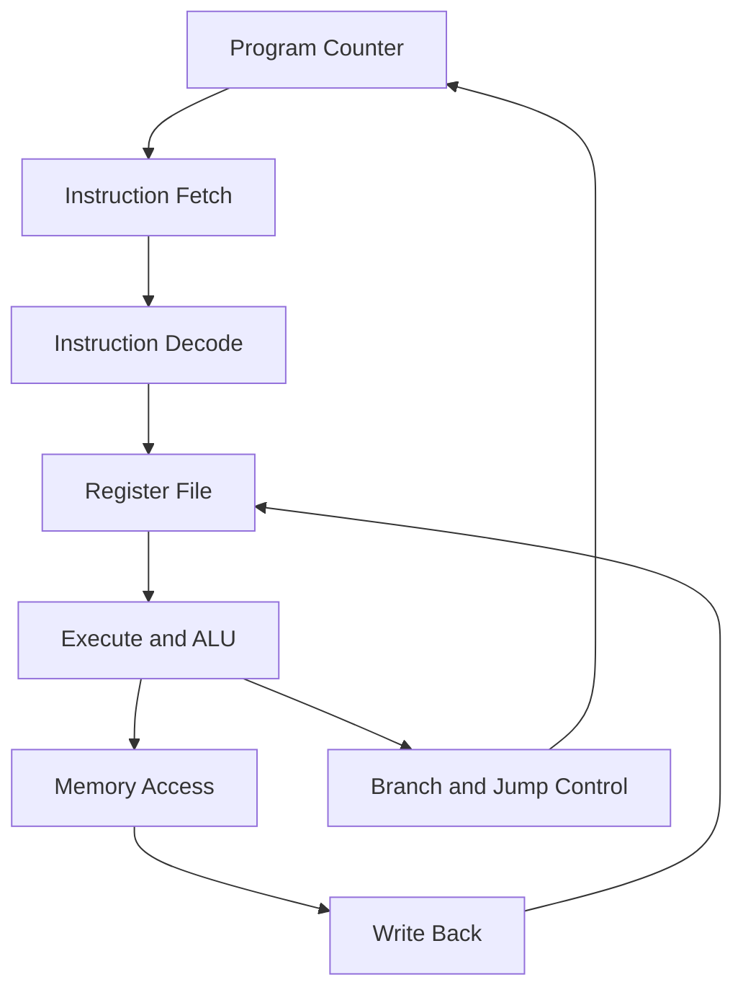
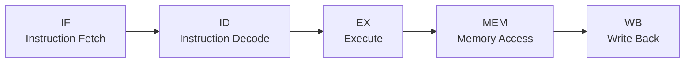

# RV32I 5-Stage Pipelined RISC-V CPU

<p align="center">
  
  
  
  
</p>

<p align="center">
  A 32-bit pipelined RISC-V processor designed in SystemVerilog, verified through simulation, and synthesized using Yosys.
</p>

<p align="center">
  <b>RTL Design | Digital Logic | Processor Architecture | Functional Verification | Logic Synthesis</b>
</p>

---

## Table of Contents

- [1. Project Overview](#1-project-overview)
- [2. Processor Architecture](#2-processor-architecture)
- [3. Five-Stage Pipeline](#3-five-stage-pipeline)
- [4. Implemented Features](#4-implemented-features)
- [5. Supported Instructions](#5-supported-instructions)
- [6. Repository Structure](#6-repository-structure)
- [7. Tools and Technologies](#7-tools-and-technologies)
- [8. Simulation and Verification](#8-simulation-and-verification)
- [9. Logic Synthesis](#9-logic-synthesis)
- [10. Waveform Analysis](#10-waveform-analysis)
- [11. Current Limitations](#11-current-limitations)
- [12. Future Improvements](#12-future-improvements)
- [13. Learning Outcomes](#13-learning-outcomes)
- [14. Author](#14-author)

## 1. Project Overview

This project implements a 32-bit RISC-V CPU using SystemVerilog and a five-stage pipeline.

The main objective is to understand how a processor executes instructions, manages data dependencies, performs arithmetic and logical operations, handles control-flow changes, and communicates with instruction and data memories.

The processor is verified using Icarus Verilog testbenches. Yosys is used to check the RTL structure and synthesize the design into a generic gate-level representation.

### Project Highlights

- 32-bit RISC-V datapath
- Five-stage processor pipeline
- Arithmetic and logical execution unit
- Conditional branch and jump control
- Register file containing 32 architectural registers
- Word load and store operations
- Pipeline stall and control-flow handling
- Directed functional verification
- RTL synthesis and structural checks

> **Project status:** The processor RTL, directed simulation tests, and Yosys synthesis flow have been exercised successfully. Full RV32I compliance and FPGA hardware validation have not been established.

## 2. Processor Architecture

The processor is divided into five pipeline stages. Each stage performs a different part of instruction execution.

### High-Level Architecture



### Main Components

| Component | Responsibility |
|---|---|
| Program Counter | Tracks the address of the next instruction |
| Instruction Fetch | Retrieves instructions from instruction memory |
| Instruction Decode | Decodes opcodes, extracts operands, and generates immediates |
| Register File | Stores and supplies architectural register values |
| Arithmetic Logic Unit | Executes arithmetic, logical, comparison, and shift operations |
| Branch and Jump Control | Determines whether execution redirects to another address |
| Memory Interface | Provides data-memory addresses, write data, and write-enable control |
| Write-Back Logic | Selects the result written to the destination register |

Instruction and data memories are provided externally through the processor's module interface.

## 3. Five-Stage Pipeline

The design follows the classic five-stage processor pipeline.



### Pipeline Stage Details

**Stage 1: Instruction Fetch (IF)**

- Uses the program counter to identify the current instruction address.
- Receives the instruction from instruction memory.
- Advances the program counter when execution is not stalled or redirected.

**Stage 2: Instruction Decode (ID)**

- Decodes the instruction fields.
- Reads source register values.
- Generates immediate values for supported instruction formats.

**Stage 3: Execute (EX)**

- Performs arithmetic and logical operations.
- Calculates memory addresses.
- Evaluates conditional branches.
- Calculates jump targets.

**Stage 4: Memory Access (MEM)**

- Interfaces with the external data memory.
- Supports the currently implemented word load and store operations.

**Stage 5: Write Back (WB)**

- Selects the result returned to the architectural register file.
- Writes results to the destination register when register-write control is enabled.
- Maintains register `x0` as zero.

### Pipeline Control

The RTL includes pipeline-valid signals, load-use stall handling, and control-flow redirection for supported branches and jumps.

A taken branch or jump can redirect instruction fetching and invalidate younger instructions in the pipeline.

## 4. Implemented Features

| Feature | Implementation |
|---|---|
| Datapath width | 32 bits |
| Architectural registers | 32 |
| Register `x0` | Hardwired to zero |
| Pipeline stages | 5 |
| Arithmetic operations | Addition and subtraction |
| Logical operations | AND, OR, XOR |
| Shift operations | Logical and arithmetic shifts |
| Comparisons | Signed and unsigned comparisons |
| Branches | Equality, inequality, signed and unsigned comparisons |
| Jumps | JAL and JALR |
| Upper immediates | LUI and AUIPC |
| Memory operations | LW and SW |
| Verification | Directed SystemVerilog testbenches |
| Synthesis | Yosys |

## 5. Supported Instructions

The RTL includes support for the following instruction groups. This table describes implemented groups, not a claim of complete architectural compliance.

### Arithmetic and Logical Instructions

- ADD, SUB
- AND, OR, XOR
- SLT, SLTU
- SLL, SRL, SRA

### Immediate Instructions

- ADDI
- ANDI, ORI, XORI
- SLTI, SLTIU
- SLLI, SRLI, SRAI

### Control-Flow Instructions

- BEQ, BNE
- BLT, BGE
- BLTU, BGEU
- JAL, JALR

### Upper-Immediate Instructions

- LUI
- AUIPC

### Memory Instructions

- LW: Load Word
- SW: Store Word

Byte and halfword load/store instructions remain future improvements.

## 6. Repository Structure

```text
RV32I-5-Stage-Pipelined-CPU/
│
├── rtl/
│   └── rv32i_core.sv
│
├── tb/
│   ├── tb_rv32i_core.sv
│   └── tb_rv32i_control.sv
│
├── sim/
│   └── Generated simulation outputs
│
├── synth/
│   └── Generated synthesis outputs
│
├── run_sim.sh
├── run_sim.bat
├── synth_run_yosys.ys
├── .gitignore
└── README.md
```

Generated simulation and synthesis files are excluded by the current `.gitignore` patterns. They can be regenerated using the supplied scripts.

## 7. Tools and Technologies

| Tool | Purpose |
|---|---|
| SystemVerilog | RTL implementation |
| Icarus Verilog | Compilation and simulation |
| GTKWave | Viewing simulation waveforms |
| Yosys | RTL synthesis and structural checking |
| Visual Studio Code | Development environment |
| WSL/Linux | Running the open-source hardware tools |
| Git and GitHub | Version control and project publication |

## 8. Simulation and Verification

The project includes directed testbenches for checking processor behavior.

### Test Coverage

The existing tests exercise:

- Register initialization and zero-register behavior
- Arithmetic and logical operations
- Register write-back
- Word load and store operations
- Load-use behavior
- Conditional branch decisions
- JAL and JALR control flow
- Flushing of selected instructions after redirects

### Running the Tests

Open a WSL/Linux terminal in the repository root.

```bash
chmod +x run_sim.sh
./run_sim.sh
```

The testbench prints the expected and observed register values and reports pass/fail results.

### Recorded Verification Result

The directed control-flow test completed with:

```text
ALL TESTS PASSED
```

This result applies to the tests implemented in the current testbench. It is not a substitute for comprehensive instruction-level, randomized, or formal verification.

## 9. Logic Synthesis

The design uses Yosys to check the RTL and synthesize the processor.

Run:

```bash
yosys -s synth_run_yosys.ys
```

The script performs operations including:

1. Reading the SystemVerilog RTL.
2. Checking the module hierarchy.
3. Converting processes into logic.
4. Optimizing the design.
5. Running structural checks.
6. Synthesizing the design.
7. Exporting the synthesized design as JSON.

### Synthesis Output

The configured synthesis script writes:

```text
synth/rv32i_core.json
```

The synthesis log is useful for examining warnings, cell statistics, and structural checks.

**Important:** Generic Yosys cell statistics are not equivalent to FPGA LUT utilization, final ASIC standard-cell area, or measured silicon performance. Those require an appropriate target technology and implementation flow.

## 10. Waveform Analysis

The testbenches generate Value Change Dump (VCD) files for simulation analysis.

For example, if the control test has generated the corresponding waveform:

```bash
gtkwave sim/rv32i_control.vcd
```

Useful signals to inspect include:

- `pc`
- `imem_addr`
- `idex_instr`
- `ex_alu_result`
- `dmem_addr`
- `dmem_wdata`
- `dmem_we`
- Pipeline-valid and stall signals

Waveform analysis helps identify instruction progression, register dependencies, memory transactions, and branch redirection.

## 11. Current Limitations

This project is an educational processor implementation and is still open to further verification and improvement.

- Only word loads and stores are currently implemented in the load/store datapath.
- Complete RV32I compliance has not been demonstrated.
- Comprehensive randomized and formal verification has not been completed.
- FPGA board validation has not been performed.
- Timing closure and ASIC physical design have not been completed.
- Interrupts, exceptions, caches, and a complete peripheral subsystem are not yet part of the design.

## 12. Future Improvements

The next development stages can expand this processor into a more complete digital system.

### Processor Improvements

- Implement LB, LH, LBU, LHU, SB, and SH.
- Expand tests for data hazards and control hazards.
- Add broader instruction-level verification.
- Measure CPI and analyze pipeline performance.

### System-on-Chip Development

- Integrate the CPU with RAM.
- Add a memory-mapped bus and address decoder.
- Implement UART communication.
- Add GPIO and a timer peripheral.
- Run small assembly programs on the integrated system.

### ASIC Design Exploration

- Explore technology-mapped synthesis.
- Add static timing analysis.
- Explore floorplanning, placement, and routing using an open-source ASIC flow.
- Document area and timing results for a specified technology.

## 13. Learning Outcomes

This project provides hands-on experience with:

- Processor datapath design
- SystemVerilog RTL development
- Instruction decoding
- Pipeline architecture
- ALU implementation
- Branch and jump control
- Hazard handling
- Testbench development
- Simulation waveform analysis
- Logic synthesis and structural verification
- Version control for hardware projects

## 14. Author

**Abhik Bhunia**

Electronics and Communication Engineering

**Interests:** VLSI Design, Digital Design, Computer Architecture, RISC-V, and Semiconductor Technology.

GitHub: [@abhik-ece](https://github.com/abhik-ece)

---

<p align="center">
  <b>Built with SystemVerilog. Verified through simulation. Synthesized with Yosys.</b>
</p>

